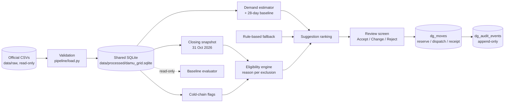

# Damu Grid: expiry-aware blood redistribution review queue

Terumo BCT Africa Hackathon 2026 · Challenge area: redistribution

Damu Grid helps a regional stock coordinator decide which eligible red-cell units can be spared at one site and used at a site that is running short, before they expire. A person Accepts, Changes or Rejects every recommendation. Sending and receiving officers then confirm dispatch and receipt. The workflow still works if the forecasting model is offline.

This README follows the official hackathon README template. Results and links will be filled during the 24-hour window. **All application code will be written between Tuesday 10 November 2026, 12:00 EAT and Wednesday 11 November 2026, 12:00 EAT.** This repository currently contains planning documents, issue drafts, and the official starter dataset only. There is no pre-written application code.

Planning docs for teammates and AI coding agents are in `docs/` and `AGENTS.md`.

## The problem

The primary user is a **regional stock coordinator** at a regional blood transfusion centre. Today that person must reconcile stock reports, see which hospitals are short, find units that will expire unused, and arrange a transfer. Sending and receiving officers must then agree on what actually left and arrived.

In the official **synthetic** starter dataset (a Kenya-modelled year, 1 November 2025 to 31 October 2026; not facts about real facilities):

- 47 facilities; 49,426 units; 17,430 hospital requests for 34,242 units, with 87% fully met (dataset README).
- About 23% of red cell and whole blood units are wasted (expired on the shelf, or discarded after the fridge got too warm), while other facilities run short (dataset README).
- Emergency resupply takes a median of about 5 hours (dataset README).
- There is no demand table; demand must be estimated from `requests` (and optionally `donations`). `daily_stock` is end-of-day inventory, not demand.

Stale reports, unconfirmed receipts and missing temperature evidence can make a plausible move unsafe. The model never releases a unit for transfusion and never overrides a quarantine.

## What we built

- What works now: planning documents, official dataset in `data/raw/`, and the intended architecture in `docs/`. Application features will be checked off here as they land in the window.
  - [x] **Data pipeline** (`pipeline/`): validates all 11 official CSVs against the data dictionary, builds one shared SQLite database, the 31 October 2026 closing snapshot (8,666 units, reconciled with `daily_stock` cell by cell), the red-cell eligibility engine (598 of 738 RBC on the shelf can be suggested; every other unit carries its exclusion reasons), data-quality handling and cold-chain flags. 71 automated tests.
- What is mocked or not finished: the working prototype, baseline numbers, UI, demo video and slides are to be built in the window. Tier 2 items are listed in `docs/IMPLEMENTATION_PLAN.md`.

Demo video (3 minutes or less): [link to be added]
Live demo: [link] · Test log-in: [user / password to be added]

## How to run it

Requirements: Python 3.11+ and [uv](https://docs.astral.sh/uv) (or `pip install pandas numpy pytest ruff`).

```bash
git clone https://github.com/Damu-Grid/damu-grid.git
cd damu-grid
uv sync
uv run python -m pipeline build     # ~15 s: validates the CSVs, writes data/processed/damu_grid.sqlite
uv run pytest                       # 71 tests (add -m "not dataset" for the 10-second subset)
```

`python -m pipeline build` prints the row counts, the closing snapshot, the cold-chain flags and how many red-cell units are eligible, with the reason for every exclusion. Nothing under `data/raw/` is written. Details: `pipeline/README.md`.

Remaining steps, to be completed as the other packages land:

1. Copy `.env.example` to `.env` (no secrets in git).
2. Install frontend deps with `pnpm` (see `frontend/README.md`).
3. Start the API and the Next.js app.
4. Sign in with the demo coordinator / sender / receiver accounts.

Judges should assume a laptop and about 10 minutes. A Docker Compose path is a Tier 2 delivery target.

## Architecture



Implemented so far: validation, shared SQLite schema, closing snapshot, cold-chain flags and eligibility (`pipeline/`). The other boxes are in progress; the full design is in `docs/ARCHITECTURE.md`.

Official CSVs → validation and local SQLite → demand estimator and rule fallback → eligibility engine → review screen → reservation / dispatch / receipt and audit.

The baseline evaluator is a separate read-only path. The wider laboratory and inventory system is an external boundary. There is no automated laboratory-override or transfusion-release endpoint.

Conceptual mappings to FHIR, ISBT 128 or DHIS2, if added, will be labelled as conceptual unless a profile is actually implemented.

## AI and data

- What the AI or data feature does: a pooled demand estimator (hospital-total RBC demand allocated by historical known-group proportions) informs recipient gaps and sender reserves. Suggestions rank eligible exact-group red-cell units by estimated use before expiry, given typical route time. This is a statistical data feature. An optional Tier 2 LLM only drafts a plain-language explanation from those numbers; it must not invent stock or demand figures.
- Baseline we compared against: for each hospital and known group, seven-day predicted requested units = 7 × (requested RBC units in the preceding 28 calendar days ÷ 28). Optional second comparison: nearest eligible site first versus expiry-aware ranking, on documented synthetic scenarios.
- Result: baseline [to be computed in the window] vs ours [to be computed in the window], on the official starter data, using the time split in `docs/EVALUATION.md` (learn 1 Nov 2025–30 Apr 2026; calibrate May–June; evaluate seven-day origins from 1 Jul 2026 through 21 Oct 2026).
- How a user sees the reason for a recommendation: each card shows unit/group, sender reserve, recipient gap, expiry, typical travel time, data age, assumed benefit, and uncertainty. Deterministic text first; optional LLM rewrite of the same numbers.
- Who approves it (Accept / Change / Reject): the regional stock coordinator. The sender rechecks and dispatches. The receiver confirms arrival. A qualified safety role controls quarantine; the model cannot clear it.
- What happens if the AI is wrong or offline: nearest eligible site matching using a simple historical demand rule, with the same safety gates and human decisions. Offline or disconnected actions remain pending until reconciled (Tier 2 sync queue).

## Data

We use the official synthetic starter dataset in `data/raw/`. Tables used for the core workflow: `facilities`, `routes`, `units`, `daily_stock`, `requests`, `transfers`. Optional / Tier 2: `donations`, `power_outages`, `temperature_logs`. Donor tables are not required for redistribution decisions and will not be displayed as personal data.

Measured on the CSVs in the window (all synthetic; details and denominators in `docs/DATA.md`):

- All 11 tables match the documented row counts; every facility reference exists in `facilities.csv`.
- Closing snapshot at 31 October 2026, 23:59:59 EAT: 8,666 units on the shelf (738 RBC), matching `daily_stock` in all 509 facility × component × group cells.
- Red cells that may be suggested: 598 of 738. Excluded: 87 officially exposed to a temperature excursion, 17 with an unconfirmed receipt, and 39 more with evidence of a fridge excursion, an outage without backup or a logger gap while on the shelf.
- Data-quality handling: 1,852 requests (10.6%) with a typed facility name that differs from the official one, keyed by `facility_id`; 442 emergency requests with unknown group, kept unknown; 1,046 transfers (3.0%) without `received_at`, never filled in; 55 sensor-glitch readings, never treated as excursions.

Licence / terms: there is no SPDX licence on the dataset. Official rules: use it freely in the hackathon and demo; say that we used the synthetic starter dataset; do not present findings as facts about real Kenyan facilities; cite any other data (we do not plan to add any); no real donor, patient or facility records. See `data/raw/README.md` and `docs/DATA.md`.

## African conditions

Facilities in the starter data include `grid_reliability`, `connectivity` (2G / 3G / 4G), and `has_blood_fridge_backup_power`. The Tier 1 product must remain usable on a basic browser and a slow connection: small payloads, visible data age, and a model-off fallback. Tier 2 adds a PWA / offline sync queue, SMS or USSD-style alert simulation (sandbox or mock only; no real patient or donor contact), and country/config settings so rules, language and branding can change without a code fork.

## AI tools we used

To be filled during the window. Tool, and what we used it for. Write "None" if none. Using AI does not cost points; hiding it, or submitting work the team cannot explain, will. Planned tools include Cursor, Claude, Codex or similar assistants for coding, plus an optional LLM API for explanation text. Each use will be listed here.

## Team

There is **no team lead**. Everyone is an equal teammate. Blessings and Timi are taking the heavier implementation tracks because they can stay most active, not because they outrank anyone.

| Name | Role (ownership area, not seniority) | Country | Presenting Friday (in person / online) |
|------|------|---------|-----------------------------------------|
| Agoro Oluwatimilehin Teslim (Timi) | Backend, workflow state machine, LLM explanations, deployment | Nigeria | To confirm |
| Blessings Mambwe | Forecasting, baseline evaluation, simulation, reproducibility | Zambia | To confirm |
| Sorgho Brayan Jovani Aboubacar | Data pipeline, schema, eligibility, cold-chain flags | Morocco | To confirm |
| Dan Boumba | Frontend, map, dashboard, UX, demo video and slides | Democratic Republic of the Congo | To confirm |

## Known limits and next steps

- Results in this README will be computed in the window on synthetic data only.
- Tier 1 is known-group RBC. Other components (for example platelets, 5-day shelf life in the dataset model) are Tier 2 and need their own policy before they are treated like red cells.
- Historical inventory will use an explicit closing snapshot, not a reconstruction from final unit locations.
- About 3% of `transfers` lack `received_at`; the dataset README says 14% of `requests` have messy typed facility names (our exact comparison finds 10.6%; we use `facility_id`); 5% of emergency requests have unknown blood group; temperature logs contain gaps and, per the dataset README, 60 sensor glitches (we find 55 readings of exactly −99.0, 99.9 or 0.0).
- Eligibility limits (7 days of life after arrival, 6-hour arrival allowance, sender reserve of 2 units, 2-hour excursion threshold, 6-hour logger gap) are team defaults in `pipeline/settings/kenya_default.toml`, not regulations, and should be reviewed with a blood-service expert.
- The dataset has no storage evidence for platelets or frozen plasma, so cold-chain flags cover red cells and whole blood only.
- The dataset README lists `blood_system.sqlite`, which was not in the official zip we received.

Next steps after the hackathon, if any, will be listed here after the demo.
