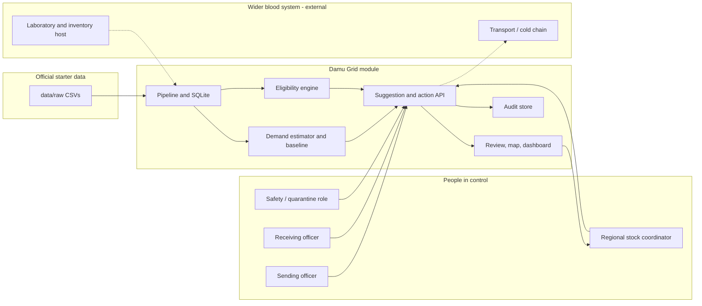
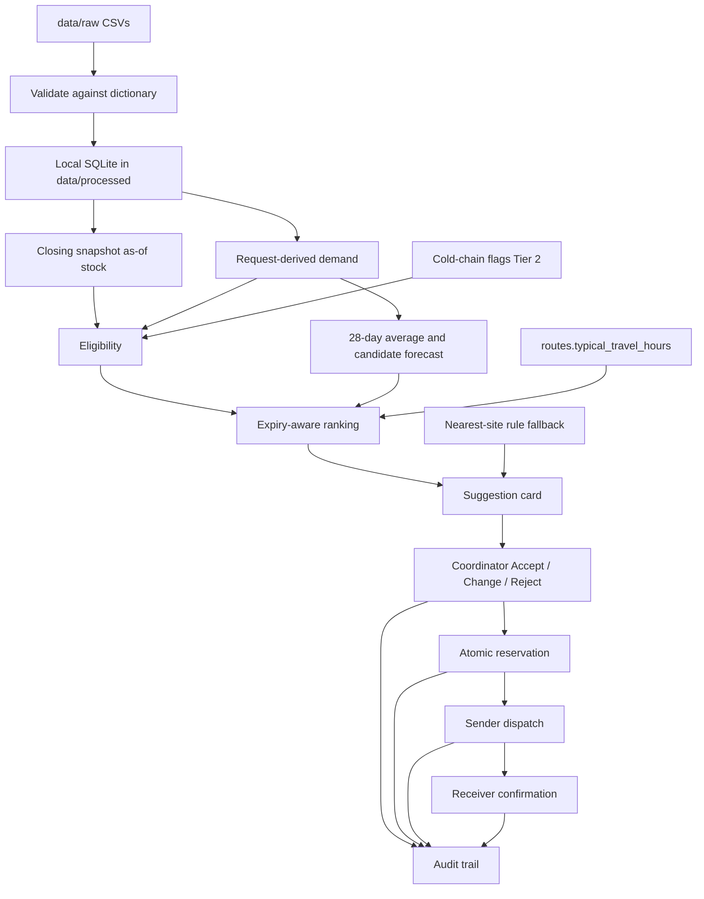
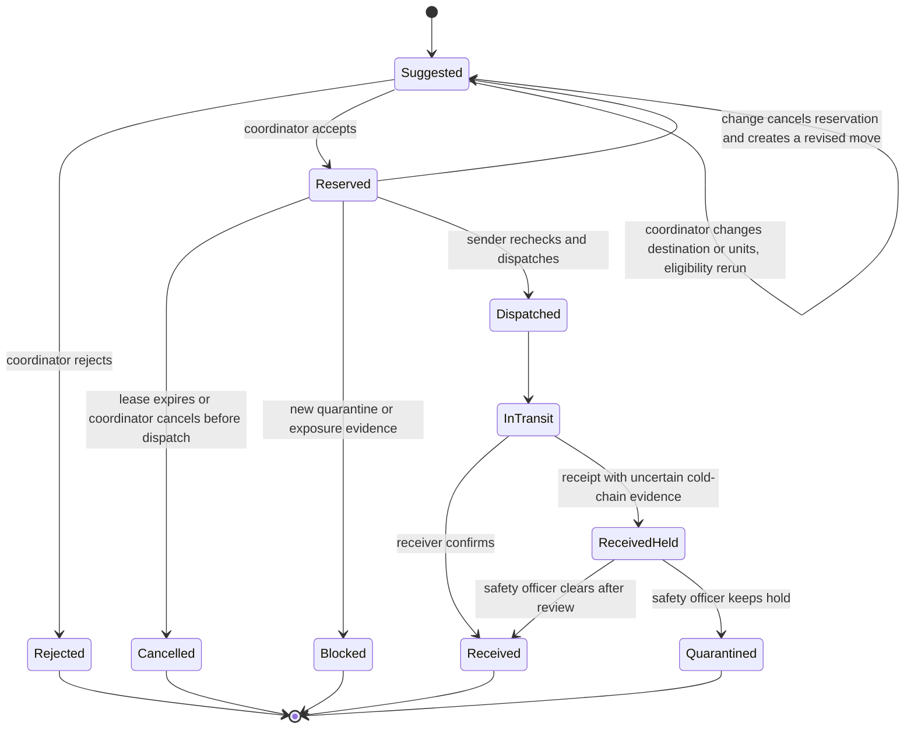

# Architecture

Damu Grid is a **stock-coordination module**, not a full blood-bank information system. It sits beside existing laboratory, inventory and transport processes. It recommends moves; people approve them; the module records reservation, dispatch and receipt. It does not release blood for transfusion.

## Context

In this hackathon the "host" is the official synthetic CSVs plus our local database. A future host adapter is conceptual only (see Blessings's design notes). No proprietary Terumo API is available.

## Component boundaries

| Component | Folder | Responsibility | Does not do |
|---|---|---|---|
| Pipeline | `pipeline/` | Load CSVs, validate, snapshot as-of stock, eligibility, cold-chain flags | Invent missing receipts or groups |
| Forecasting | `forecasting/` | Demand estimator, 28-day baseline, metrics | Change reserved stock |
| Simulation | `simulation/` | Scenario replay and policy comparison | Claim real-world lives or money saved |
| Backend | `backend/` | FastAPI, state machine, audit, optional LLM text, optional SMS simulation, config | Transfusion release, compatibility decisions |
| Frontend | `frontend/` | Review queue, sender/receiver views, map, dashboard, PWA | A second stock ledger |

The baseline evaluator is a **read-only** path over historical `requests`. It must not write reservations.

## Data flow

## State machine

A recommendation is not ownership of a unit. Acceptance is not dispatch and is not transfusion release.

Rules (from the adopted design, to implement in-window):

- Reservations are atomic and version-checked. Duplicate accept of the same unit fails.
- A reservation lease is short (design note: at most 30 minutes; confirm in settings).
- Change reruns eligibility.
- Quarantine after approval blocks dispatch. Quarantine raised in transit is preserved at receipt.
- Incomplete cold-chain evidence at receipt never clears a quarantine and never implies transfusion release.
- A dispatched transfer cannot be silently deleted as if it never moved.
- Offline or disconnected actions stay `pending_sync` until the shared store accepts them (Tier 2).
- Only the expected role performs coordinator, sender, receiver or safety actions. A role is not enough without facility scope in a later host; the demo uses clearly named demo actors.

## Shared database schema

One SQLite file, `data/processed/damu_grid.sqlite`, built by `python -m pipeline build`. Official tables keep their official names and columns; every added table is prefixed `dg_` (`dg_snapshot_meta`, `dg_snapshot_units`, `dg_cold_chain_flags`, `dg_moves`, `dg_audit_events`). The database refuses a second active move for the same unit and any edit or deletion of audit rows. Full description: `pipeline/README.md`.

## API contract

See `docs/API_SPEC.md`. Shared interfaces required by the evaluation:

1. **One suggestion object** carrying unit IDs, source, destination, component/group, as-of time, expiry, route time, reserve, recipient gap, reason and uncertainty.
2. **One action function** that validates state and writes the decision plus audit row in a transaction.

## Deployment shape

Tier 1: one local FastAPI process, one SQLite file, one Next.js app. Docker Compose is the preferred way to make "how to run it" reliable for judges (Tier 1 if time, otherwise Tier 2). Optional public hosting (Render / Vercel, following Timi's prior operational experience) is Tier 2 and must not delay the video.

## Standards (conceptual unless implemented)

Unit identity in the official data is a synthetic `unit_id` of the form `U<yymm>-<centre>-<serial>-<component>`. ISBT 128, FHIR R5 `BiologicallyDerivedProduct` / `SupplyRequest` / `SupplyDelivery`, and DHIS2 aggregates may be documented as mappings. Do not pretend a conformant integration exists.
